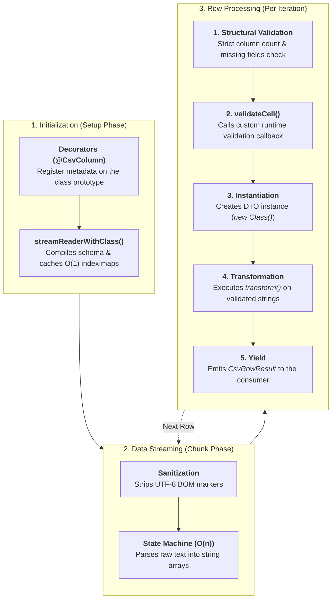

# csv-airstream

*[Documentation en français](https://github.com/jetonpecheCorp/csv-airstream/blob/main/README.fr.md)*

An ultra-lightweight, zero-dependency CSV streaming library.
Designed to process massive data volumes on Node.js, Deno, Bun, and modern browsers without causing memory spikes (OOM).

## Why choose csv-airstream?

* **Standard Web Streams API**: Works natively in browsers and on servers (Node.js, Edge) without requiring polyfills or external adapters.

* **Magic Typing (DTO Decorators)**: Bind complex CSV headers (e.g., `name *`, `active (0,1)`) directly to your TypeScript classes using `@CsvColumn` and `@CsvIndex` decorators.

* **Auto-Sniffing**: The `"auto"` mode intelligently guesses the delimiter (comma, semicolon, tab...) by analyzing the first few lines.

* **Zero Crash (Result Pattern)**: Instead of crashing your application at the first error, the stream returns an explicit `{ ok: true, data }` or `{ ok: false, error }` object row by row.

* **Simplified Export**: Built-in utility functions to easily save data to your disk (`createFileWriter`) or trigger an HTTP download (`toResponse`).

* **RFC 4180 Compliant**: Natively handles multiline cells, escaped quotes, and UTF-8 BOM headers.

> **NOTE for pros (Performance & Memory)**:
`csv-airstream` never buffers the entire file in memory. Furthermore, column mapping (Schema Resolution) is computed only once at startup. Then, each read or written row uses O(1) index access (Zero Overhead), guaranteeing blazing-fast speeds even on multi-gigabyte files.

## 📑 Table of Contents

- [Why choose csv-airstream?](#why-choose-csv-airstream)
- [Architecture & Lifecycle](#architecture--lifecycle)
- [Installation](#installation)
- [Quick Start](#quick-start)
  - [1. Easy Mapping with Classes (DTO)](#easy-mapping-with-classes-dto)
  - [2. Headerless Files with @CsvIndex](#headerless-files-with-csvindex)
  - [3. Raw Reading (Without Typing)](#raw-reading-without-typing)
  - [4. Note on Reading Files (Paths vs Streams)](#note-on-reading-files-paths-vs-streams)
  - [5. Custom Transforms](#custom-transforms)
  - [6. Browser Usage (Frontend)](#browser-usage-frontend)
  - [7. Error Handling](#error-handling)
- [Full Example: Data Cleaning](#full-example-data-cleaning)
- [File & Web Export](#file--web-export)
- [API Reference](#api-reference)
- [Benchmark & Performance](#benchmark--performance)

## Architecture & Lifecycle
To guarantee optimal performance and a minimal memory footprint, `csv-airstream` strictly separates the configuration phase from the stream processing phase.  
Here is the exact execution order when using `streamReaderWithClass`:



### Important Details
- Decorators are evaluated only once at startup. `transform` functions are cached.
- `validateCell` is always called before class instantiation and transformation. It always receives the raw string value.
- `transform` is executed only if the cell successfully passes validation. The result is directly injected into the new DTO instance.

## Installation
```bash
npm install @jetonpeche/csv-airstream
```

## Quick start

### Easy mapping with Classes (DTO)
Transform your CSV rows directly into clean, validated TypeScript objects.

```ts
import { Csv, CsvColumn } from "@jetonpeche/csv-airstream";

class UserDto 
{
    // Looks for the exact "name *" column in the CSV
    @CsvColumn("name *", { required: true, order: 0 })
    name!: string;

    @CsvColumn("is active (0, 1) *", { order: 1 })
    isActive!: string;
}

const csvData = `name *;is active (0, 1) *
Jane Doe;1`;

// READ: The "auto" mode guesses that the delimiter is a semicolon
for await (const row of await Csv.streamReaderWithFile(csvData, UserDto, { delimiter: "auto" })) 
{
    if (row.ok)
        console.log(`User: ${row.data.name}, Active: ${row.data.isActive}`);
}

// WRITE: Automatically generates headers in the right order (order: 0, 1)
const writer = await Csv.createFileWriter("./export.csv", UserDto, { delimiter: ";" });

await writer.write({ name: "Jane Doe", isActive: "1" });
await writer.close();
```

### Headerless Files with `@CsvIndex`
If your CSV file doesn't have a header row, you can bind your properties directly to the column index (0, 1, 2...).

```ts
import { Csv, CsvIndex } from "@jetonpeche/csv-airstream";

class LogEntryDto 
{
    @CsvIndex(0, { required: true }) 
    timestamp!: string;

    @CsvIndex(1) 
    level!: string;

    @CsvIndex(2) 
    message!: string;
}

const rawLogs = `2026-10-06T08:00:00Z,INFO,Server started
2026-10-06T08:00:01Z,WARN,Memory spike detected`;

for await (const row of await Csv.streamReaderWithFile(rawLogs, LogEntryDto)) 
{
    if (row.ok) 
        console.log(`[${row.data.level}] ${row.data.message}`);
}
```

### Raw Reading (Without Typing)
Read a file quickly without creating a class beforehand.

```ts
import { Csv } from "@jetonpeche/csv-airstream";

const rawCsv = `id,name,price
1,Keyboard,49.99
2,"Wireless Mouse",24.50`;

for await (const row of await Csv.streamReaderWithFile(rawCsv, undefined, { hasHeader: true })) 
{
    if (row.ok) 
        console.log(`Line ${row.line}: ${row.data.name} ($${row.data.price})`);
}
```

### Note on Reading Files (Paths vs Streams)
It is crucial to understand the difference between providing a file path and providing a stream to the library:

#### 1. You have a local file path (e.g.,` ./assets/data.csv`):
Always use `Csv.streamReaderWithFile()`. If you pass a path directly to `streamReader`, the parser will think the string `"./assets/data.csv"` is the actual CSV content!

```ts
// BEST PRACTICE (Node.js):
const reader = await Csv.streamReaderWithFile("./assets/data.csv", UserDto);
```

#### You have a stream or raw text (e.g., Browser, API, Fetch): 
Use the native `streamReader()` or `streamReaderWithClass()` methods. These methods are "agnostic" and work across any environment (Browser, Edge, Deno...).

```ts
// BEST PRACTICE (Browser / Fetch):
const response = await fetch("[https://api.com/data.csv](https://api.com/data.csv)");
const reader = Csv.streamReaderWithClass(response.body, UserDto);
```

### Custom Transforms
You can transform any raw value on the fly into an array, date, or complex object using the `transform` option directly in the decorator.

```ts
import { Csv, CsvColumn } from "@jetonpeche/csv-airstream";

class ProductDto 
{
    @CsvColumn("name") name!: string;

    // Converts "red|blue|green" into an array ["red", "blue", "green"]
    @CsvColumn("colors", { transform: (val) => val.split("|").map(c => c.trim()) })
    colors!: string[];

    // Applies a custom date format
    @CsvColumn("created_at", { transform: (val) => new Date(val).toISOString() })
    createdAt!: string;
}

const csvData = `name,colors,created_at
T-Shirt,red|blue,2026-10-06T10:00:00Z`;

for await (const row of await Csv.streamReaderWithFile(csvData, ProductDto)) 
{
     // Outputs the JavaScript array
    if (row.ok)
        console.log(row.data.colors);
}
```

>*Tip*: You can also override these transforms at runtime (without modifying the class) by passing the `transformers: new Map(...)` option into `Csv.streamReaderWithClass()`.

### Browser Usage (Frontend)
Read massive files directly from the user's browser without crashing the tab, using the native `File.stream()` API:
```js
document.getElementById('csvFileInput').addEventListener('change', async (event) => 
{
    const file = event.target.files[0];
    if (!file) 
        return;

    // file.stream() returns a native ReadableStream, perfect for csv-airstream!
    for await (const row of Csv.streamReader(file.stream(), { hasHeader: true })) 
    {
        if (row.ok)
            console.log("Read row:", row.data);
    }
});
```

### Error handling
```ts
try 
{
    for await (const row of await Csv.streamReaderWithFile(stream, UserDto)) 
    {
        if (row.ok) 
            console.log(row.data);
    }
} 
catch (error) 
{
    // Catches critical stream errors (e.g., file not found, network drop)
    console.error("Stream was interrupted:", error);
}
```

## Full Example: Data Cleaning
Here is a realistic scenario: an inventory file arrives poorly formatted (comments, random delimiters, incorrect values). We will read it, validate it, and write a clean file to the hard drive.

```ts
import { Csv, CsvColumn } from "@jetonpeche/csv-airstream";

class InventoryItemDto 
{
    @CsvColumn("product sku #", { required: true, order: 0 }) 
    sku!: string;

    @CsvColumn("product name *", { required: true, order: 1 }) 
    name!: string;

    @CsvColumn("unit price (usd)", { required: true, order: 2 }) 
    price!: string;

    @CsvColumn("in stock", { order: 3 }) 
    stock!: string;
}

// A dirty CSV file: BOM header, comments (#), incomplete lines
const dirtyCsv = `\uFEFF# Inventory Export Lot 42
# Date: 2026-10-06
product name *;product sku #;unit price (usd);in stock
Mechanical Keyboard;TECH-101;129.99;15
Wireless Mouse;TECH-202;39.50;50
;TECH-303;-10.00;0
27" Monitor;DISP-404;249.00;8`;

async function runInventoryPipeline() 
{
    // Reads and validates data on the fly
    const reader = await Csv.streamReaderWithFile(dirtyCsv, InventoryItemDto, {
        delimiter: "auto", // Finds the semicolon automatically!
        comment: "#",      // Ignores lines starting with #
        trim: true,        // Trims extra whitespaces
        strictColumnCount: true,
        validateCell: (value, { columnName }) => 
        {
            // Custom rule: reject negative prices
            if (columnName === "unit price (usd)" && Number(value) < 0) 
                return "NEGATIVE_PRICE_FORBIDDEN";

            return true;
        }
    });

    // Prepares the writer stream to output a clean file
    const writer = await Csv.createFileWriter("./clean_inventory.csv", InventoryItemDto, { delimiter: "," });

    let successCount = 0;
    let failureCount = 0;

    // Pipes data from one stream to the other
    for await (const row of reader) 
    {
        if (row.ok) 
        {
            await writer.write(row.data);
            successCount++;
        } 
        else 
        {
            failureCount++;
            console.warn(`Line ${row.line} skipped [${row.error.code}]: ${row.error.message}`);
        }
    }

    await writer.close();

    console.log(`Done: ${successCount} exported, ${failureCount} rejected.`);
}

runInventoryPipeline();
```

## File & Web Export

### Save to Disk (Node.js)
```ts
import { Csv, CsvColumn } from "@jetonpeche/csv-airstream";

class ExportDto 
{
    CsvColumn("ID", { order: 0 }) 
    id!: string;

    @CsvColumn("Title", { order: 1 }) 
    title!: string;
}

const writer = await Csv.createFileWriter("./exports/report.csv", ExportDto);

await writer.write({ id: "1", title: "Stream processing" });
await writer.write({ id: "2", title: 'Escaped "quotes"' });
await writer.close(); // Automatically handles file saving!
```

### HTTP Download (Next.js, Cloudflare, Express...)
Instantly create an API Response ready to be downloaded by the user.

```ts
import { Csv, CsvColumn } from "@jetonpeche/csv-airstream";

class CustomerDto
{
    @CsvColumn("customer_id") 
    id!: string;

    @CsvColumn("full_name") 
    name!: string;
}

export async function GET() 
{
    const writer = Csv.streamWriterWithClass(CustomerDto);

    // Start writing in the background
    (async () => {
        await writer.write({ id: "101", name: "Alice Dupont" });
        await writer.write({ id: "102", name: "Bob Martin" });
        await writer.close();
    })();

    // Returns a standard Web Response with the correct headers (Content-Disposition)
    return Csv.toResponse(writer, "customers.csv");
}
```

## API Reference

### Decorators
`@CsvColumn(header, options?)`: Binds a property to a header text.

| Parameter | Type | Description |
|:--- |:--- |:--- |
| `header` | `string` | The column name in the source CSV. |
| `options.required` | `boolean` | If `true`, rejects the row if the cell is empty. |
| `options.order` | `number` | The column display order during export (e.g., 0, 1, 2). |
| `options.type` | `"string" \| "number" \| "boolean" \| "date"` | Automatic conversion of primitive values. |
| `options.transform` | `(value: string) => any` | Custom conversion function executed for each cell. |
| `options.booleanValues` | `BooleanCastOptions` | Provides a list of values ​​to determine `true` and `false` values. |
| `options.numberOptions` | `NumberCastOptions` | Number configuration, e.g., `{ decimalSeparator: ",", strict: true }` |

`@CsvIndex(index, options?)`: Maps a property to a numeric position.

| Parameter | Type | Description |
|:--- |:--- |:--- |
| `index` | `number` | The column position (starts at 0). |
| `options.required` | `boolean` | If `true`, rejects the row if the cell is empty. |
| `options.type` | `"string" \| "number" \| "boolean" \| "date"` | Automatic conversion of primitive values. |
| `options.transform` | `(value: string) => any` | Custom conversion function executed for each cell. |
| `options.booleanValues` | `BooleanCastOptions` | Provides a list of values ​​to determine a `true` value and a `false` value. |
| `options.numberOptions` | `NumberCastOptions` | Number configuration, e.g., `{ decimalSeparator: ",", strict: true }` |

### Typed Methods (DTOs)
`Csv.streamReaderWithClass(source, dtoClass, options?)`  
Reads the CSV and transforms it into instances of your class.
* Automatically enables headers (`hasHeader: true`).   
* Automatically enforces required fields.

`Csv.streamWriterWithClass(dtoClass, options?)`  
Creates a write stream configured by your class.

* `options.columnsOrder` *(array)* : Allows enforcing a different column order at export time.
* `options.alwaysQuote`*(boolean)* :Forces adding quotes around every cell.

### Export Utilities
* `Csv.createFileWriter(filePath, dtoClass?, options?)`: Creates a stream directly connected to a file (ideal for Node/Bun/Deno).
* `Csv.writeFile(filePath, data, dtoClass?, options?)`: One-shot method to write an array to a file.
* `Csv.toResponse(writer, filename)` : Converts the stream into a browser download (ideal for APIs).

### Reader Options (CsvReaderOptions)

| Option | Type | Default | Description |
|:--- |:--- |:--- |:--- |
| `delimiter` | `"string \| "auto"` | `","` | The separator character. `"auto"` automatically detects the separator. |
| `hasHeader` | `boolean` | `false` | If `true`, uses the first row as object keys instead of returning an array. (Enabled by default with decorators). |
| `trim` | `boolean` | `false` | Removes whitespace from the beginning and end of text values. |
| `strictColumnCount` | `boolean` | `true` | Rejects rows where the number of columns does not match the header. |
| `validateCell` | `Function` | `undefined` | `Callback (value, context) => boolean \| string` to validate each cell on the fly. |
| `skipEmptyLines` | `boolean` | `false` | Skips rows that are completely empty or contain only separators. |
| `comment` | `string` | `undefined` | Skips rows starting with this prefix (e.g., `"#"`). |
| `targetClass` | `Class` | `undefined` | Instantiates each row using this class (requires a parameterless constructor). |

### Writer Options (CsvWriterOptions)

| Option | Type | Default | Description |
|:--- |:--- |:--- |:--- |
| `delimiter` | `string` | `","` | The separator character between columns. |
| `writeBom` | `boolean` | `false` | Adds the UTF-8 marker (BOM) to the beginning of the file. Essential for Excel on Windows. |
| `columnsOrder` | `string[]` | `undefined` | Forces a specific column order for export, ignoring the class order. |
| `alwaysQuote` | `boolean` | `false` | Forces Enclose all cells in quotation marks. |
| `quoteChar` | `string` | `'"'` | The character used to enclose cells containing special characters. |
| `lineTerminator` | `"\r\n" \| "\n"` | `"\r\n"` | The line break added at the end of each record. |

## Benchmark & Performance

`csv-airstream` is designed to combine extreme speed with memory safety. The table below demonstrates the parser's linear scalability across different file sizes (tested on Node.js):

| Processed File | Rows Analyzed | Read Time (Parse) | Write Time (Str) | Max RAM Footprint |
| :--- | :--- | :--- | :--- | :--- |
| :--- | :--- | :--- | :--- | :--- |
| **92.73 Mo**| **1 000 000**| **1.1 s**| **2.6 s**| **~15 Mo**|
| **480.62 Mo** | **5 000 000** | **4.8 s** | **12.7 s** | **~27 Mo** |
| **965.48 Mo** | **10 000 000**| **9.7 s**| **26.7 s**| **~23 Mo**|
| **4.8 Go** | **50 000 000**| **50.5 s**| **146.3 s**| **< 10 Mo**|


> **How were these metrics measured?**
> Execution times were timed via `Date.now()`. RAM consumption was measured by polling `process.memoryUsage().heapUsed` every 100 milliseconds while the native stream read the file.

**Test Conditions & Parsed Data:**
This test is not a simple text stream read. The measured time includes all the following heavy operations processed on-the-fly for every row:
* **I/O Reading** (`fs.createReadStream`).
* **CSV Parsing:** Splitting 7 distinct columns per row.
* **Structural validation:** Strict verification of the expected column count.
* **DTO Mapping & Typing:** Instantiation of `UserDto` objects.
* **Automatic casting:** Converting strings to native types (e.g., `"42.5"` -> `Number`, `"true"` -> `Boolean`).

### Benchmark Code
Here is the exact code executed to obtain these results:

```ts
import fs from 'node:fs';
import { Readable } from 'node:stream';
import { Csv, CsvColumn } from '@jetonpeche/csv-airstream';

class UserDto {
    @CsvColumn("id", { type: "number" }) id!: number;
    @CsvColumn("first_name") firstName!: string;
    @CsvColumn("last_name") lastName!: string;
    @CsvColumn("email") email!: string;
    @CsvColumn("is_active", { type: "boolean" }) isActive!: boolean;
    @CsvColumn("score", { type: "number" }) score!: number;
    @CsvColumn("created_at") createdAt!: string;
}

async function runBenchmark() 
{
    console.log("Starting load test...");
    
    const stats = fs.statSync(TARGET_FILE);
    const sizeMb = (stats.size / 1024 / 1024).toFixed(2);
    
    const memorySnapshots: any[] = [];
    let rowCount = 0;
    
    // Measure memory every 100ms
    const interval = setInterval(() => {
        const mem = process.memoryUsage();
        memorySnapshots.push({
            timeMs: Date.now() - startTime,
            heapUsedMb: mem.heapUsed / 1024 / 1024
        });
    }, 100);

    const startTime = Date.now();
    
    const nodeStream = fs.createReadStream(TARGET_FILE);
    const webStream = Readable.toWeb(nodeStream) as any;
    
    for await (const row of Csv.streamReaderWithClass(webStream, UserDto)) 
    {
        if (row.ok)
            rowCount++;
    }

    const endTime = Date.now();
    clearInterval(interval);
    
    const durationSec = ((endTime - startTime) / 1000).toFixed(2);
    const rowsPerSec = Math.round(rowCount / (endTime - startTime) * 1000);
    
    console.log(`\n Benchmark finished!`);
    console.log(`Processed rows: ${rowCount.toLocaleString()}`);
    console.log(`Total time: ${durationSec} seconds`);
    console.log(`Speed: ${rowsPerSec.toLocaleString()} rows / second`);
}

runBenchmark();
```

**Memory Footprint Analysis:**  
The graph above illustrates a perfect stream behavior. Although the file reaches up to gigabytes, the memory footprint never blows up. The "sawtooth" pattern shows that memory is temporarily allocated (a regular spike under 40 MB) to create objects, and then immediately freed by the Node.js Garbage Collector.

**Result**: Zero memory leaks and total protection against Out Of Memory crashes, regardless of the file size.

## License
MIT